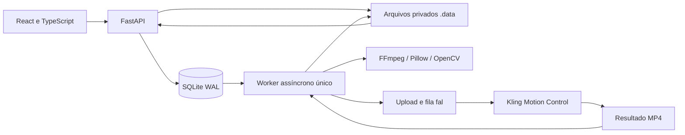

# MAYCOM CHEF CONTROL — arquitetura

Esta versão implementa um estúdio privado para um operador, com backend real e inferência externa. A interface, os arquivos e a fila local podem operar sem GPU; a geração requer a API paga fal/Kling. Não há um cluster GPU próprio, isolamento por usuário ou implantação pública realizada nesta entrega.

## Componentes



| Componente | Implementação |
| --- | --- |
| Frontend | React, TypeScript e Vite; uploads, revisão, configurações, preview, comparação e histórico. |
| API | FastAPI; validação Pydantic, controle de acesso opcional, arquivos e tarefas. |
| Persistência | SQLite em modo WAL; registros de assets e jobs, transações para limitar e retirar tarefas da fila. |
| Arquivos | `.data/assets`, `.data/jobs` e `.data/tmp`; diretórios privados e caminhos definidos pelo servidor. |
| Worker | Uma corrotina no processo Uvicorn; uma geração ativa por vez, com fila local durável. |
| Mídia | Pillow para imagens; FFprobe/FFmpeg para inspeção, extração, corte e MP4; OpenCV/NumPy para diagnósticos. |
| Inferência | Adaptador `FalMotionProvider`; Kling v3 ou v2.6, standard/pro. |

A separação do adaptador permite trocar a implementação de inferência sem reescrever uploads, histórico e interface. Isso é uma fronteira de código existente; não significa que qualquer modelo já possa ser selecionado. Wan Animate permanece uma alternativa pesquisada.

## Fluxo de arquivos e inferência

1. O servidor recebe o upload em blocos, limita tamanho/cota e cria um identificador aleatório. O nome fornecido pelo usuário não determina o caminho em disco.
2. A camada de mídia identifica conteúdo decodificável, dimensões, duração, FPS e áudio. A referência precisa ser vídeo. Vídeos recebem análise visual amostrada; imagens são verificadas por Pillow.
3. O asset nasce com revisão `pending`. Aprovação/rejeição exige `MAYCOM_REVIEW_TOKEN`; aprovação demanda confirmação humana do escopo de uso. Geração exige os dois arquivos aprovados.
4. `POST /api/jobs` valida papéis, revisão, duração e declarações. Sem `FAL_KEY` ou token de revisão, o servidor recusa o pedido.
5. O worker prepara uma imagem PNG de identidade. Quando a entrada da personagem é vídeo, extrai somente o primeiro frame. O trecho escolhido da referência é cortado e convertido em MP4.
6. Os arquivos são enviados ao armazenamento fal com TTL solicitado de um dia. O adaptador submete o endpoint escolhido com segurança do provedor ativada e persiste o ID remoto.
7. O worker consulta a fila externa. Não existe porcentagem confiável desse motor; o estado é apresentado por etapa e, se fornecida, posição de fila.
8. Ao concluir, baixa o MP4, valida o domínio e os redirecionamentos, aplica limites de tamanho e verifica mídia. FFmpeg converte a saída em MP4 H.264 com 24 ou 30 FPS; o áudio, quando presente, é tratado na exportação.
9. O backend produz métricas visuais, registra o relatório, remove intermediários da tarefa e disponibiliza preview/download. `completed` significa que o arquivo passou pelo fluxo técnico, sem certificar naturalidade ou identidade.

## Estados e recuperação

```text
queued → preparing → submitting → running → validating → completed
                      ↘ failed / cancelled ↙
```

A fila padrão aceita até 20 tarefas ativas. Uma trava de arquivo sobre `.data/worker.lock` permite somente um worker por diretório. Execute Uvicorn com `--workers 1`; não compartilhe esse diretório entre réplicas.

O ID remoto é persistido antes de continuar o polling. Após reinício, tarefas ativas com ID remoto voltam à consulta, sem nova submissão paga. Tarefas interrompidas sem ID são marcadas como falha; o operador deve conferir o painel fal antes de reenviar. Não existe garantia de exatamente uma submissão: uma conexão pode cair depois de o provedor aceitar o pedido, antes de devolver seu ID.

Leituras remotas recuperáveis têm tentativas limitadas. A submissão paga não é repetida automaticamente. O tempo limite padrão é de 30 minutos por tentativa do worker; excedê-lo solicita cancelamento remoto quando há ID. Cancelamento local não comprova cancelamento instantâneo, ausência de custo ou estorno.

O worker preserva falhas em registros de tarefa e remove intermediários de tarefas encerradas com falha/cancelamento. Resultados concluídos ficam disponíveis até exclusão pelo operador. O histórico não registra a chave do provedor nem URLs assinados como mensagens públicas.

## API

| Método e caminho | Uso |
| --- | --- |
| `GET /api/health` | Saúde básica do processo. |
| `GET /api/capabilities` | Disponibilidade de configuração e limites publicados. |
| `POST /api/session` | Cria sessão após validar o token de acesso, quando configurado. |
| `POST /api/session/logout` | Remove a sessão do navegador. |
| `GET`, `POST /api/assets` | Lista e envia arquivos; upload multipart com `file` e `role`. |
| `GET /api/assets/{id}/file` | Serve upload autorizado. |
| `POST /api/assets/{id}/review` | Aprova/rejeita com cabeçalho `X-Review-Token`. |
| `DELETE /api/assets/{id}` | Exclui upload sem vínculo com gerações. |
| `GET`, `POST /api/jobs` | Lista histórico e cria tarefa. |
| `GET /api/jobs/{id}` | Consulta estado, logs e relatório. |
| `POST /api/jobs/{id}/cancel` | Solicita cancelamento local/remoto. |
| `GET /api/jobs/{id}/output` | Preview do MP4; `?download=true` solicita download. |
| `DELETE /api/jobs/{id}` | Exclui tarefa encerrada e arquivos locais. |

As rotas retornam mensagens de erro próprias para a interface, evitando expor caminhos internos, tokens e respostas integrais dos serviços. A documentação OpenAPI pode ser consultada no processo de desenvolvimento; acesso a ela não é uma validação de inferência.

## Acesso, revisão e retenção

O padrão de execução é `127.0.0.1:8000`. Quando `MAYCOM_ACCESS_TOKEN` está definido, as APIs privadas aceitam Bearer token ou sessão assinada do estúdio. A sessão do navegador dura oito horas, usa cookie HttpOnly/SameSite e marca Secure quando a requisição é HTTPS. Não há cadastro, recuperação de senha, papéis de equipe ou isolamento de arquivos entre pessoas que compartilham o token.

`MAYCOM_REVIEW_TOKEN` é uma credencial diferente, destinada à revisão do operador. A revisão registrada não é prova jurídica de autorização, verificação biométrica ou detector de idade. O produto limita o uso a personagens fictícias adultas e cenas não íntimas. A política do provedor continua aplicável e sua segurança não é desativada.

Os diretórios de dados são criados com permissões privadas e os uploads com acesso restrito no sistema de arquivos. Isso não representa criptografia em repouso. Proteja os volumes e backups na hospedagem. Nunca exponha `.data` como diretório estático; os arquivos passam pelas rotas da aplicação.

O aplicativo permite excluir gerações e uploads locais respeitando os vínculos. Para apagar um upload, elimine primeiro as gerações que o referenciam; tarefas ativas devem encerrar ou ser canceladas. Arquivos enviados ao fal solicitam TTL de um dia. A aplicação não comprova a exclusão externa de resultados, logs e backups nem substitui as políticas de retenção do serviço.

## Limites de operação e evolução

A cota padrão local é de 10 GiB. Uploads: 20 MiB por imagem e 150 MiB por vídeo; fonte de vídeo com no máximo 300 segundos. A geração usa trecho de 3–30 segundos, com teto de 10 segundos para orientação pela imagem. O worker reserva espaço antes de começar preparação/download. Downloads do provedor são limitados a 512 MiB. Limites adicionais de dimensões, pixels e FPS protegem o processamento local; não são limites comerciais garantidos do motor.

O aplicativo usa processos FFmpeg com timeout e sem interpolar nomes de arquivos em comandos shell. Ainda assim, é um serviço que decodifica mídia não confiável: mantenha as bibliotecas atualizadas e use limites de recursos na hospedagem. A configuração atual é para operação privada; antes de disponibilizá-lo a terceiros, acrescente autenticação por usuário, autorização por recurso, quotas/cobrança por conta, limites de requisição, observabilidade operacional e política de retenção apropriada.

Escalar horizontalmente exige substituir a trava local/fila SQLite por um broker e banco compartilhados, separar workers da API, introduzir leases de execução e armazenamento de objetos privado. Esses componentes não estão implementados. A capacidade de inferência externa é administrada pelo fal; o aplicativo não configura GPU própria nem promete latência.

## Reprodução

Instalação: `uv sync --frozen` em `backend` e `npm ci && npm run build` em `frontend`. Execução: `.venv/bin/uvicorn app.main:app --host 127.0.0.1 --port 8000 --workers 1` em `backend`. Os scripts da raiz automatizam essa sequência. Consulte o [README](../README.md) para variáveis e o [contrato do provedor](../backend/app/providers/README.md) para integração.
